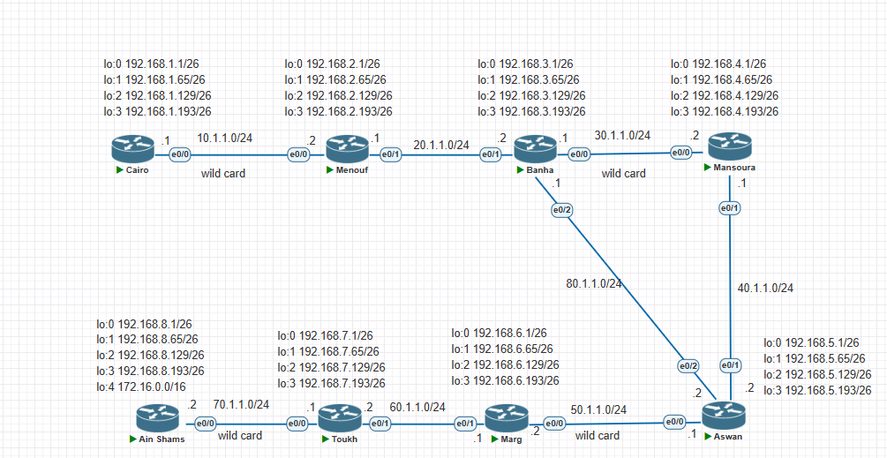
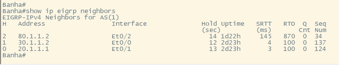
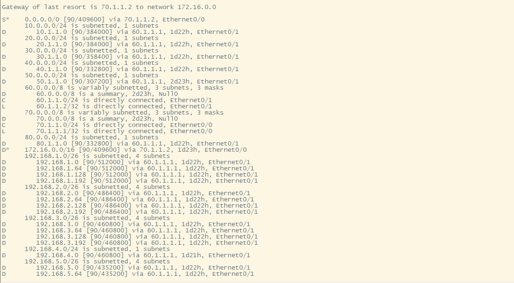
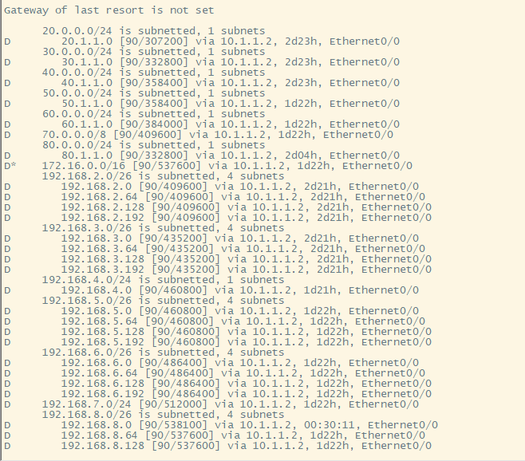
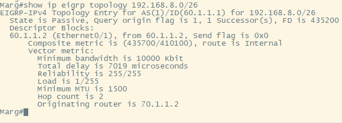
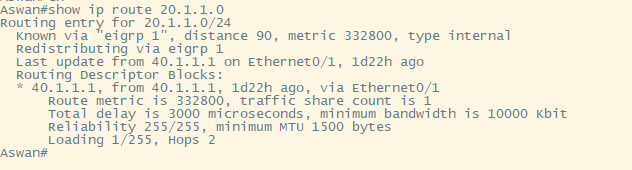
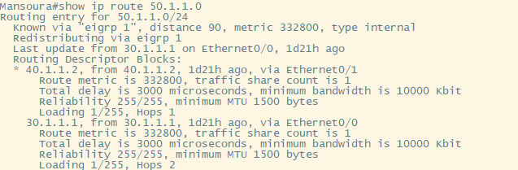
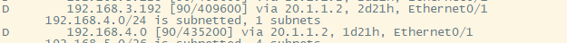

# EIGRP Traffic Engineering and Default Routing Lab

Eight Cisco routers running EIGRP AS 1, built on PNETLab.



## Base Setup
- Four /26 loopbacks on every router (192.168.1.0 to 192.168.8.0)
- Loopbacks and inter-router links advertised in EIGRP



## EIGRP Network Statements per Router
```
! Cairo
router eigrp 1
network 10.1.1.0 0.0.0.255
network 192.168.1.0

! Menouf
router eigrp 1
network 10.1.1.0 0.0.0.255
network 20.0.0.0
network 192.168.2.0

! Banha
router eigrp 1
network 20.0.0.0
network 30.1.1.0 0.0.0.255
network 80.0.0.0
network 192.168.3.0

! Mansoura
router eigrp 1
network 30.1.1.0 0.0.0.255
network 40.0.0.0
network 192.168.4.0

! Aswan
router eigrp 1
network 40.0.0.0
network 50.1.1.0 0.0.0.255
network 80.0.0.0
network 192.168.5.0

! Marg
router eigrp 1
network 50.1.1.0 0.0.0.255
network 60.0.0.0
network 192.168.6.0

! Toukh
router eigrp 1
network 60.0.0.0
network 70.1.1.0 0.0.0.255
network 192.168.7.0
auto-summary

! Ain Shams
router eigrp 1
network 0.0.0.0
network 70.1.1.0 0.0.0.255
network 172.16.0.0
network 192.168.8.0
```

## Task 1: Unconditional Gateway of Last Resort
Router: Ain Shams
```
ip route 0.0.0.0 0.0.0.0 Loopback0
router eigrp 1
 network 0.0.0.0
```

## Task 2: Conditional Gateway of Last Resort
Routers: Ain Shams and Toukh

Ain Shams:
```
interface Loopback4
 ip address 172.16.0.1 255.255.0.0
router eigrp 1
 network 172.16.0.0
```
Toukh:
```
ip default-network 172.16.0.0
```

Result: Toukh shows "Gateway of last resort is 70.1.1.2 to network 172.16.0.0".
Cairo receives 172.16.0.0/16 as a candidate default, but its gateway of last resort is not set.





## Task 3: Offset List
Router: Marg

Goal: add 500 to the metric of 192.168.8.0/26 received from Ain Shams.
```
access-list 1 permit 192.168.8.0 0.0.0.63
router eigrp 1
 offset-list 1 in 500 Ethernet0/1
```
Result: metric increased from 435200 to 435700.



## Task 4: Administrative Distance
Router: Aswan

Goal: reach 20.1.1.0/24 via Mansoura then Banha, not directly via Banha.
```
access-list 1 permit 20.1.1.0 0.0.0.255
router eigrp 1
 distance 95 80.1.1.0 0.0.0.255 1
```
Result: route installed via 40.1.1.1 (distance 90, metric 332800).



## Task 5: Equal-Cost Load Balancing
Router: Mansoura

Goal: use both paths to 50.1.1.0/24.
Calculation: 332800 - 307200 = 25600
```
access-list 1 permit 50.1.1.0 0.0.0.255
router eigrp 1
 offset-list 1 in 25600 Ethernet0/1
```
Result: two equal-cost paths, via Aswan and via Banha.



## Task 6: Manual Summarization
Configured on Mansoura, observed on Menouf.

- Summary on e0/0 only: Menouf received the /24 and also the four /26
  routes, advertised through e0/1 via Aswan and Banha.
- Summary on both interfaces: Menouf received only 192.168.4.0/24.
```
interface range Ethernet0/0 - 1
 ip summary-address eigrp 1 192.168.4.0 255.255.255.0
```
Lesson: summarize on every interface that can advertise the specific routes.


